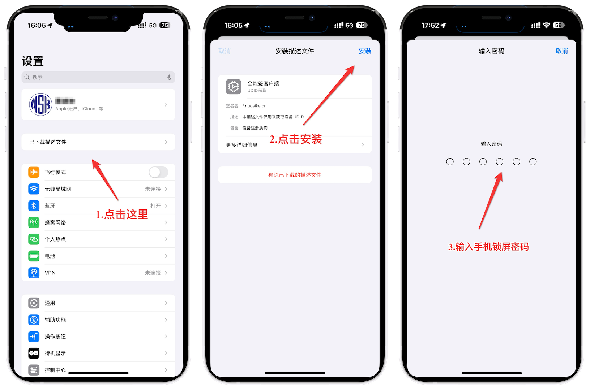
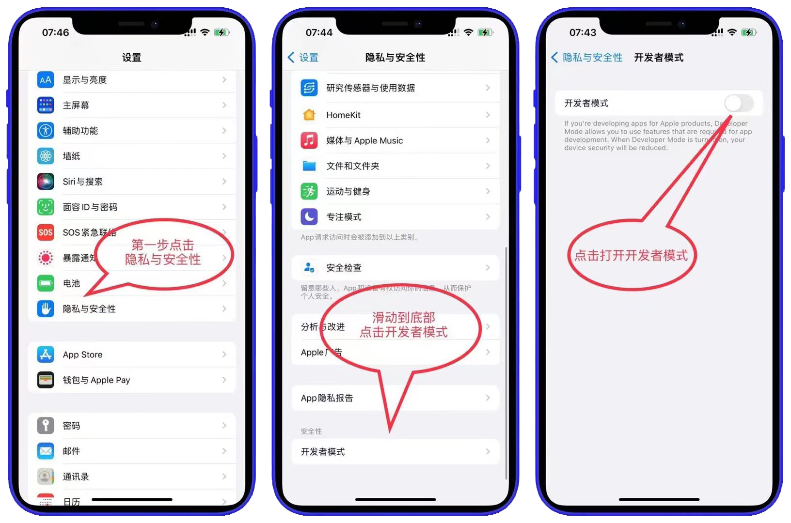

<p align="center">
  
</p>

<h1 align="center">GuoDuo</h1>

<p align="center">原生 SwiftUI 的红果短剧客户端，适配 iPhone Duo 折叠屏、iPad 与普通 iPhone，还能和电视联动。开源免费，非官方。</p>

红果短剧官方 App 在折叠屏内屏和 iPad 上没有适配，所以做了 GuoDuo。界面和播放全部是原生实现（SwiftUI + AVPlayer）：竖滑追剧、弹幕、环境光、折叠屏半折布局都有。1.0 版本又加了奈飞式首页、账号同步、电视遥控，还能在手机和电视之间互相接着看。

> ⭐ **点个 Star，再关注 [@81199000](https://github.com/81199000)，避免走失。** 官网 **[oneduo.app](https://oneduo.app)** 是长期固定入口，以后仓库再搬家也能从官网找到。

## 同系列项目

- **[DouDuo](https://github.com/81199000/DouDuo)**：第三方抖音客户端，原生 SwiftUI，适配折叠屏内屏 / iPad，推荐、评论、私信、直播都能用。
- **[GuoDuo](https://github.com/81199000/GuoDuo)**（本项目）：红果短剧第三方客户端，原生播放，适配折叠屏 / iPad，和 GuoDuo TV 联动。
- **[GuoDuo TV](https://github.com/81199000/GuoDuo-TV)**：GuoDuo 的安卓电视 / 投影仪版：遥控器刷剧，手机扫码当遥控器，和手机版互相接着看。
- **[一键签 OneDuo](https://github.com/81199000/OneDuo)**：Windows / Mac 装机工具，用自己的 Apple ID 免费把上面这些 App 签名装到手机，到期自动续签、有新版自动更新。
- 官网 **[oneduo.app](https://oneduo.app)**：所有项目的统一下载入口。

## 1.0 有什么新东西

**全新首页（两套主题可切）**
- **奈飞主题**（默认）：大海报，整页底色跟着封面主色变；下面一排排横向滑动：继续观看、我的追剧、今日热播 Top 10（描边大数字）、各个榜单。
- 顶部分区：全部 / 真人剧 / 漫剧 / AI 剧 / 系列剧 / 西饭 / 河马。按屏幕宽度自动排，放不下的收进「类别」菜单。选中的分区字变色，其他分区照常显示。
- 往下滑时分区栏收起，往上滑时弹回来。折叠屏展开后，顶部那一行和右上角的时间对齐。
- **红果主题**：官方剧场同款的两列大卡瀑布流。在「设置 → 首页主题」里切换。

**搜索**
- 没输入时显示「热门搜索」和「为你推荐」，推荐的剧点右边的播放键直接开播。
- 边打字边出联想，剧名带封面和热度，演员带参演作品数。
- 搜索结果都有封面；粘贴红果分享链接也能直接打开那部剧。

**推荐**
- 竖滑一屏一部，后台提前备好，点进来就播；顶部频道：关注 / 合集 / 漫剧 / 真人剧 / 推荐。
- 右侧按钮栏和首页菜单一样宽；从首页进推荐、再退回首页，按钮栏从菜单的位置长出来、再缩回去，切换不突兀。

**播放**
- 竖滑切集，起播大约 0.5 秒；横滑快进快退（带预览）、长按加速、倍速、画中画。
- 黑边环境光：画面两侧的黑边会透出画面颜色的光（关 / 亮 / 中 / 暗 / 很暗）。
- 「更多」面板是液态玻璃效果：选集、弹幕、极简模式、铺满全屏、沉浸式、投到电视、倍速、弹幕密度 / 透明度 / 字号。
- 分集评论显示真实昵称和头像，滑到底自动加载更多。
- 听书模式：退出 App 后继续出声（默认关）。

**账号**
- 手机号 + 验证码登录，或扫码登录红果账号。
- 登录后同步个性化推荐、云端观看记录、收藏、预约。观看记录按账号分开存，换号各看各的。

**电视联动（GuoDuo TV）**
- **安装到电视**：手机自动找家里的安卓电视，把 GuoDuo TV 推过去装好。
- **连接遥控器**：扫电视上的二维码，或在局域网里自动发现电视。方向键、确定、返回、主页、音量，电视在播时还能暂停、快进、下一集。
- **扫码登录电视**：手机扫电视登录页上的二维码，用手机的红果账号确认，电视就登录好了。
- **手机 ↔ 电视接着看**：手机看到一半，点「更多 → 投到电视」，电视从同一集同一秒接着播；在遥控器里点「接到手机继续看」，再从电视接回手机。
- **扫一扫**：「我的」右上角有扫一扫，长按 App 图标也能直接扫码或连接遥控器。扫码会自动分辨电视遥控码、电视登录码和红果分享链接。

**折叠屏 / iPad**
- 桌面半折：上半屏放视频，下半屏是操作台（滑动快进 / 上下切换、弹幕、环境光投影）。
- 书本半折：左边放视频，右边常驻选集。
- 外屏、内屏、横竖屏都单独调过布局。

**我的 / 设置**
- 官方同款排版：头像、红果号、关注 / 粉丝 / 获赞；历史、收藏、点赞、预约。
- 设置页按 iOS 设置的样式分组：外观（首页主题）、播放（环境光 / 弹幕 / 听书）、存储、设备、关于。
- 封面和头像缓存在本地，翻回来或重新打开 App 不用重新加载。「缓存管理」里能看到占了多少空间，一键清理。
- 关于页：版本、检查更新、开源致谢。

每个版本的改动见 [更新说明](docs/releases/) 或 [GitHub Releases](https://github.com/81199000/GuoDuo/releases)。

## 下载安装

支持 iOS / iPadOS **18.4 及以上**。GuoDuo 没有上架 App Store，安装包是**未签名 IPA**，需要签名后安装。有两种方式：

| | 方式一：一键签（推荐） | 方式二：全能签 + 软件源 |
| --- | --- | --- |
| 花钱吗 | 免费（用自己的 Apple ID） | 要买证书 |
| 要电脑吗 | 要（Windows / Mac） | 不要，全程在手机上 |
| 有效期 | 7 天，**自动续签** | 跟证书走，一般 1 年 |
| 更新新版 | 自动装上 | 软件源里点一下，签名安装 |

### 方式一：一键签（免费，自动续签）

1. 到官网 **[oneduo.app](https://oneduo.app)** 下载 [一键签](https://oneduo.app/#download)（Windows / Mac）
2. 数据线连手机，在一键签里选 **GuoDuo**，点 **一键安装**
3. 手机上 **设置 → 通用 → VPN 与设备管理** 信任你的 Apple ID

详细步骤见 [一键签使用教程](https://github.com/81199000/OneDuo#使用教程)。

> 更新也在一键签里完成：有新版会自动装上，观看记录和收藏会保留。

### 方式二：全能签 + GuoDuo 软件源（手机上安装和更新）

[全能签](https://sign.drnrt8.cn/sign/)是手机上的签名工具：导入证书后，在 App 里就能下载、签名、安装，**不用电脑**。

> **全能签本身免费，但必须有证书才能用。** 顺序是「先有证书 → 再装全能签」。

#### 1. 买证书

两种渠道：**全能签官网买兑换码**（证书和全能签一起装好，适合新手），或 **淘宝 / 闲鱼买证书**（便宜些，拿到 `.p12` + `.mobileprovision` + 密码）。

买之前先拿到手机的 **UDID**：用 **Safari** 打开 [全能签官网](https://sign.drnrt8.cn/sign/) 点「获取 UDID」，按提示安装描述文件。



<sub>图片来自[全能签官网](https://sign.drnrt8.cn/sign/)安装页教程。</sub>

#### 2. 安装全能签

- **兑换码**：在 [全能签官网](https://sign.drnrt8.cn/sign/) 输入兑换码 →「立即安装」。
- **自己的证书**：在官网点「我有证书 ｜ 自助安装」，上传 `.p12` 和 `.mobileprovision`，填密码 →「签名安装」。

装好后在 **设置 → 通用 → VPN 与设备管理** 信任证书；再打开 **设置 → 隐私与安全性 → 开发者模式**，按提示重启。



<sub>图片来自[全能签官网](https://sign.drnrt8.cn/sign/)安装页教程。</sub>

#### 3. 把证书导入全能签

全能签 → **设置 → 导入文件**，选 `.p12` 和 `.mobileprovision`（或证书 zip 包），输入密码。在 **证书** 页看到状态有效即可。

#### 4. 添加软件源，签名安装

全能签 → **资源 → 软件源** → 右上角添加：

| 软件源 | 地址 |
| --- | --- |
| 官方源（推荐，国内可用） | `https://dl.oneduo.app/guoduo/guoduo.json` |
| GitHub | `https://raw.githubusercontent.com/81199000/GuoDuo/main/docs/source/guoduo-github.json` |

在源里点 GuoDuo → 下载 → **资源 → App** 里点它 → **签名** → **安装**。以后有新版，在源里下拉刷新再装一次，会覆盖旧版，观看记录和收藏保留。

> ⚠️ 买来的证书可能被苹果吊销（「掉签」），掉签后 App 打不开，只能换证书重签。买之前问清楚掉签补不补。不要用网上流传的免费 / 共享证书。

### 电视版 GuoDuo TV

安卓电视 / 盒子用的版本，项目主页 **[GuoDuo TV](https://github.com/81199000/GuoDuo-TV)**。最简单的装法：手机打开 GuoDuo →「我的 → 设置 → 安装到电视」，按提示打开电视的 ADB 调试，手机会自动找到电视并装好。装好后在「连接遥控器」里扫电视上的码，就能遥控和互相接着看。

## 常见问题

- **打开就闪退**：签名过期了。一键签：点「立即全部续签」；全能签：看证书是否失效（掉签），换证书重签
- **某部剧放不了**：部分集数只有 ByteVC2 编码，iOS 不支持；或在红果需要解锁
- **推荐 / 取源全部失败**：红果接口变了，等修复后更新 GuoDuo
- **占用空间大**：「我的 → 设置 → 缓存管理 → 清理缓存」
- **找不到电视**：手机和电视要连同一个 Wi‑Fi，电视上的 GuoDuo TV 要开着；也可以在「连接遥控器」里手动输入电视上显示的地址
- **在 App 里发不了评论**：红果会把第三方客户端发的评论设成「仅自己可见」，所以 GuoDuo 只做看评论

## 构建

需要 Xcode 26 以上、Node.js 和 [XcodeGen](https://github.com/yonaskolb/XcodeGen)。

```sh
git clone https://github.com/81199000/GuoDuo.git && cd GuoDuo
brew install xcodegen
cd core && npm ci && node build.cjs && cd ..
xcodegen generate
xcodebuild -project HongGuo.xcodeproj -scheme HongGuo -destination 'generic/platform=iOS Simulator' build CODE_SIGNING_ALLOWED=NO
```

## 目录结构

- `core/upstream/`：取源核心（签名 / 设备注册 / 目录 / 搜索 / 取源），原样搬运自上游，只改了 transport 路径，版本见 `core/UPSTREAM_COMMIT`
- `core/account-feed.cjs`、`core/catalog-more.cjs`、`core/phone-login.cjs`：账号推荐流、云端记录、手机号登录、分集评论、搜索联想、扫码登录电视
- `core/shims/`：Node 内置模块在 JavaScriptCore 里的替身
- `core/entry.js`：导出给 Swift 调用的 `HG.*` 接口
- `HongGuo/Core/HGCore.swift`：JSContext 宿主 + Native.*（网络、AES、摘要、gzip、计时器）
- `HongGuo/Core/HGCencDecryptor.swift`：CENC AES-CTR MP4 解密
- `HongGuo/Core/HGTVRemote.swift`、`HongGuo/UI/HGTVRemoteView.swift`：GuoDuo TV 发现、绑定、遥控、手机 ↔ 电视接着看
- `HongGuo/Player`、`HongGuo/Storage`：播放器手势、弹幕、环境光、缓存管理，改自 [DouDuo](https://github.com/81199000/DouDuo)（MIT）

## 同步上游

取源核心的上游更新由脚本自动同步：

```sh
python3 scripts/upstream_sync.py --check   # 只看上游有没有更新、改了哪些我们用的文件
python3 scripts/upstream_sync.py           # 同步 → 打本地补丁 → 构建核心 → 实测取源 → 本地提交
```

- 用到的上游文件和本地改动都登记在脚本里的 `FILES` / `PATCHES`。改了上游文件的本地写法，**必须同步登记到 `PATCHES`**，否则下次同步会被上游原文覆盖。
- 补丁打不上（上游改到同一处），或实测取源成功率低于 80% 时，脚本会自动还原、不提交，交给人处理。
- `scripts/upstream_watch.sh --release` 可由定时任务每小时跑一次：上游有更新就同步、实测，实测通过后直接发版。

## 发版（维护者）

1. 升 `project.yml` 的 `MARKETING_VERSION`
2. 写 `docs/releases/v<版本>.md`（App 内更新弹窗直接显示它的内容）
3. 提交并推送后运行 `./release.sh`：编译未签名 IPA，发布 GitHub Release，并同步 oneduo.app 软件源

## 免责声明

> 本声明说明项目意图与边界，**不构成法律意见，也不能免除法律责任**。

GuoDuo 是非官方客户端，与红果短剧 / 字节跳动、西饭、河马及任何内容方**没有任何隶属、合作或授权关系**，不存储、不提供任何视频内容，片源均来自各平台接口。接口未公开，随时可能失效；不支持 ByteVC2 编码的集数。仅供个人学习研究使用，请勿用于商业用途或传播，所有商标归各自权利人所有。

仓库和软件源只提供**未签名 IPA**，由使用者用 [一键签](https://oneduo.app)（自己的 Apple ID）或自备证书签名安装。本项目**不出售、不提供任何证书**，与全能签及各证书卖家无合作关系；证书来源、掉签等风险由使用者自行判断。请勿分发已签名安装包。

## 致谢、上游与许可

GuoDuo 参考和使用了以下两个上游项目，感谢原作者：

- **取源核心**：[jackotom/hongguo-drama](https://github.com/jackotom/hongguo-drama)（GPL-3.0）。`core/upstream/` 原样搬运自它，在 App 里用 JavaScriptCore 运行。它的上游贡献者包括 woshishiq1/drpys、N3urda/hongguoTV、tsukiyo-zero/hongguoTV、charlie901208/HGTV 等，详见 [NOTICE](NOTICE) 和各文件头部。
- **参考实现**：[Amor5207/lvguo-tv](https://github.com/Amor5207/lvguo-tv)（绿果 TV，GPL-3.0）。账号推荐流、云端观看记录 / 收藏、手机号登录、分集评论、头像地址、写接口签名这些部分，照它的请求格式实现（没有直接拷贝文件），详见 [NOTICE](NOTICE)。

另外，播放器、手势、弹幕引擎和折叠屏布局来自姊妹项目 [DouDuo](https://github.com/81199000/DouDuo)（MIT）。

本项目以 [GPL-3.0](LICENSE) 协议开源：你可以自由使用、修改和再分发，但衍生作品同样必须以 GPL-3.0 开源。
